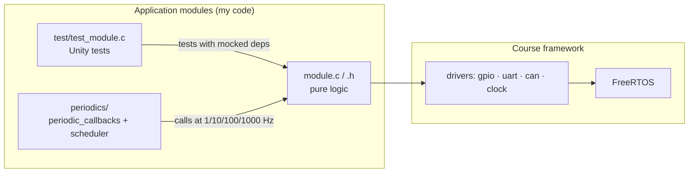

<div align="center">

# 🔧 Embedded-on-SJ2

### Five hands-on labs, from blinking an LED to talking on a CAN bus


**CMPE 243 · Industrial Applications with CAN Bus · San Jose State University**

[📚 Lab problem statements](http://books.socialledge.com/books/industrial-applications-with-can-bus/chapter/labs) &nbsp;•&nbsp; [🏎️ The course project: Nimble-RC](https://github.com/tanmayhc7/Nimble-RC)

</div>

---

## ✨ About

My solutions to the lab series of **CMPE 243** under Prof. Preet Kang at SJSU, written in C for the **SJ2 board** (ARM Cortex-M4F) on top of **FreeRTOS**.

The labs build on each other. By the end you have a unit-tested, layered firmware stack that reads sensors, parses GPS data and exchanges messages over CAN. The RC-car course project that grew out of it lives in its own repo: **[Nimble-RC](https://github.com/tanmayhc7/Nimble-RC)**.

## 🗺️ The labs

| # | Lab | What I built | Folder |
|:-:|---|---|---|
| 1 | 💡 **Switch & Blinky** | Switch-driven LED logic with a **periodic scheduler** that runs callbacks at fixed rates (1 Hz, 10 Hz, 100 Hz, 1 kHz) | `Lab1_SwitchBlinky/` |
| 2 | 🧪 **Unit testing with mocks** | A message processor, two queue implementations and a steering decision module, each fully covered by **Unity** tests with mocked dependencies | `Lab2_UTs/` |
| 3 | 🛰️ **Serial comms (GPS & UART)** | A **line buffer**, a **GPS module** that parses NMEA sentences, and a **fake GPS** to test without hardware | `Lab3_Serial Comm(GPS&UART)/` |
| 4 | 🚌 **CAN bus** | CAN initialisation, a message handler and a **tilt sensor** node that sends data across the bus | `Lab4_CAN/` |
| 5 | 📜 **CAN with DBC** | Reference material for describing the bus in a DBC file and inspecting it with BusMaster, plus a working **demo video** | `Lab5_CAN_DBC/` |

## 🧩 How a lab is structured



Each module keeps its **logic separate from the hardware drivers**, so it can be tested on a laptop with mocks of `gpio`, `uart`, `queue` and `clock`. Only then does it get wired into the periodic callbacks that run on the board.

## 📁 Repository layout

```text
Embedded-on-SJ2/
├── Lab1_SwitchBlinky/
│   └── Sol/                       # switch_logic, periodics, main.c
├── Lab2_UTs/Lab2_UTs/
│   ├── message_processor/
│   ├── queue_logic_2a/  queue_logic_2b/
│   └── steer_logic/
├── Lab3_Serial Comm(GPS&UART)/
│   └── Lab3_SerialComm/
│       ├── fake_gps/  gps_module/  line_buffer_module/
│       └── (periodics/)
├── Lab4_CAN/LAb4/
│   ├── Lab4_CAN/  can_init/  can_msg_handler/  tilt_sensor/
│   └── main.c  periodics/
└── Lab5_CAN_DBC/                  # DBC / BusMaster docs + Demo.mp4
```

Every folder with logic has a `test/` directory next to the source (`test_<module>.c`). The lab handouts (PDF) sit beside each lab for reference.

## 🚀 Running it

The code targets the course's SJ2 development environment, which provides the SCons build, the Unity and mock tooling, and the board support code.

```bash
git clone https://github.com/tanmayhc7/Embedded-on-SJ2.git
```

Copy a lab's module folders into the `l5_application` directory of the [SJ2 starter project](https://gitlab.com/sjtwo-c-dev/sjtwo-c), then build and test from the project root:

```bash
scons          # runs the unit tests, then builds the firmware
```

> 💡 Unit tests run on your host machine, so Labs 2 and 3 are worth running even without a board.

## 🛠️ Skills practised

`Embedded C` · `FreeRTOS tasks & queues` · `Periodic scheduling` · `UART / NMEA parsing` · `CAN bus & DBC` · `Test-driven development` · `Mocking hardware`

---

<div align="center">

Built by [Tanmay Chandavarkar](https://github.com/tanmayhc7) · Course by Prof. Preet Kang, SJSU

</div>
